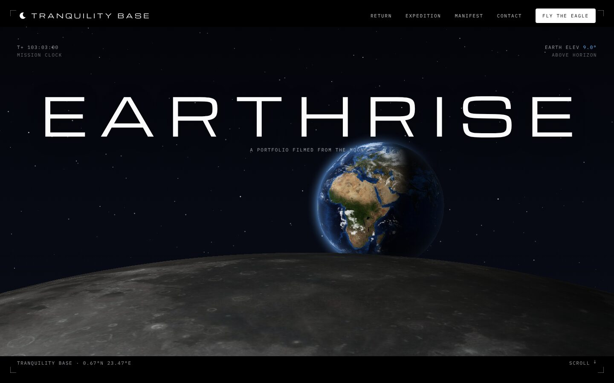
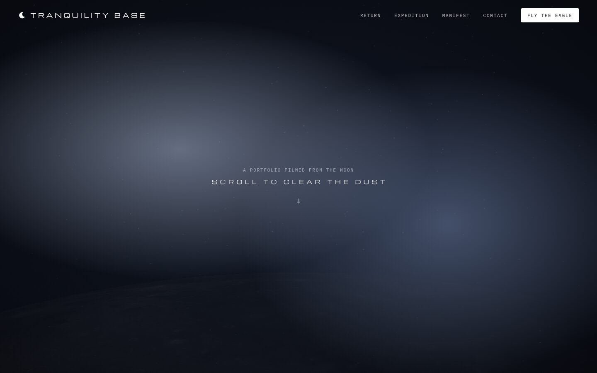
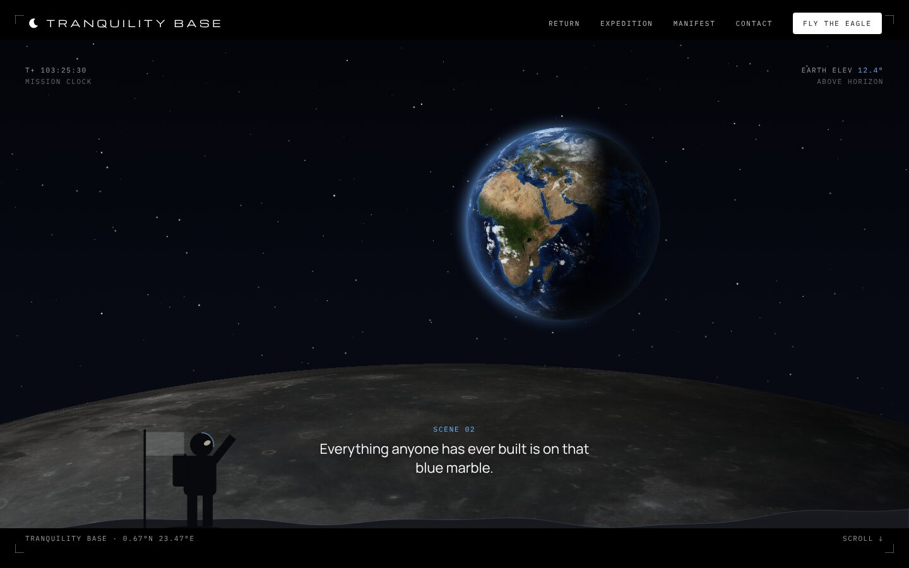
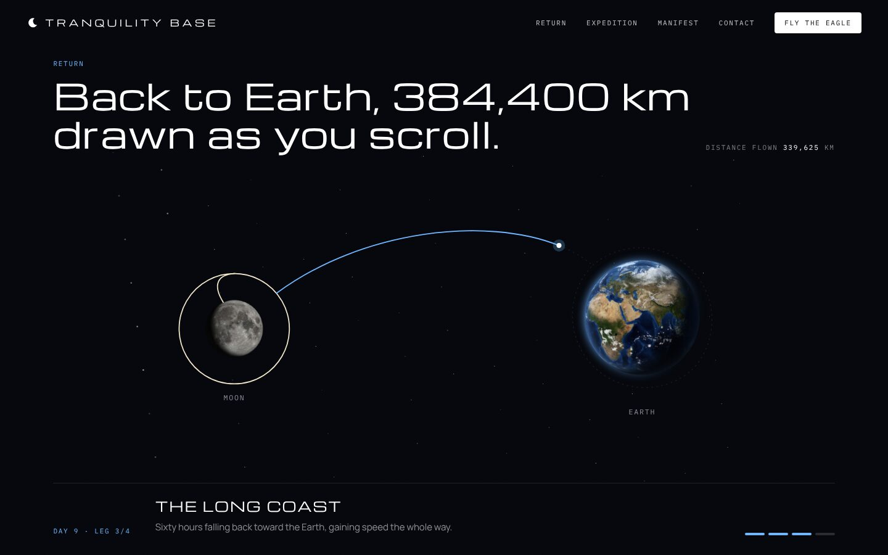
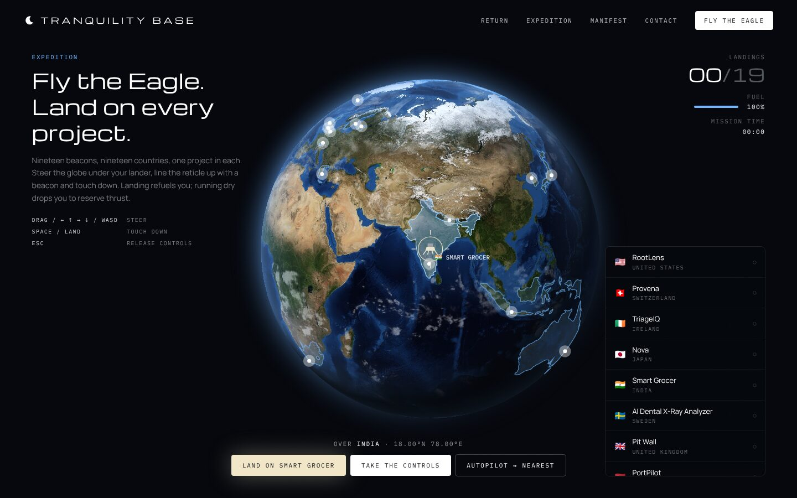
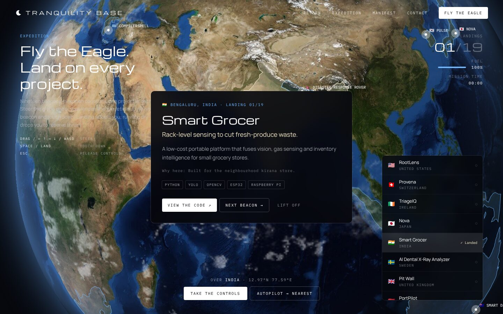
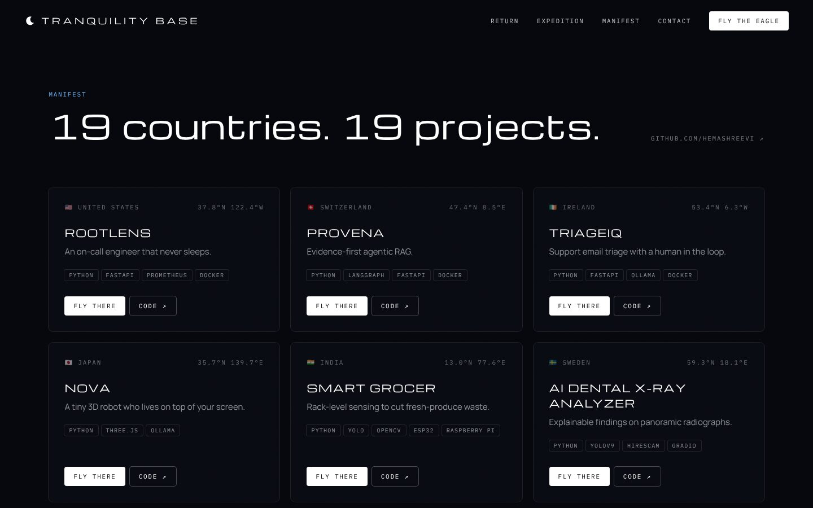
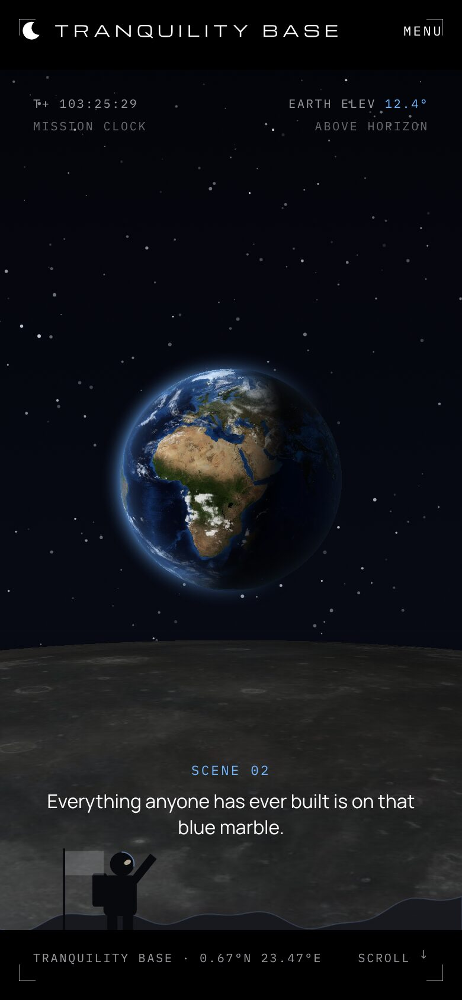
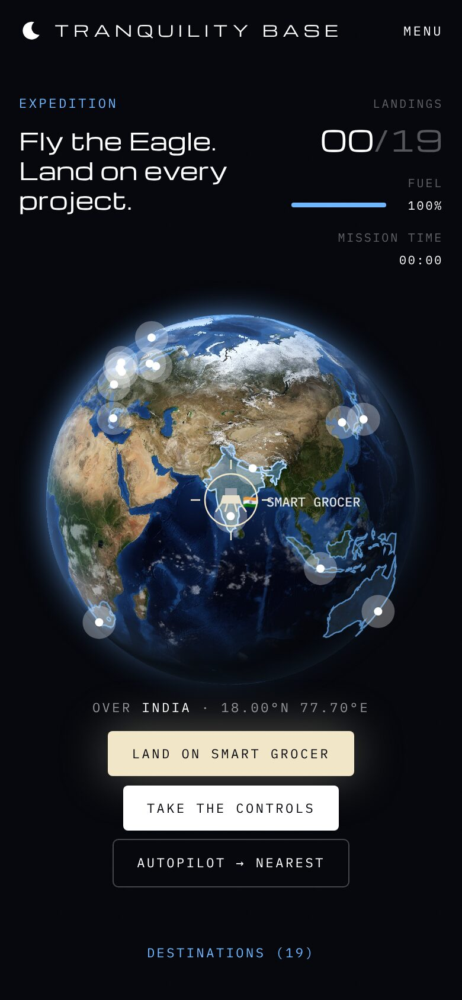

# Tranquility Base

A cinematic portfolio for [HemashreeVI](https://github.com/HemashreeVI): scroll to clear the dust and watch the **real Earth rise over the real Moon**, fly 384,400 km home, then **pilot the Eagle** across the globe. Each of 19 countries holds one project.



## The film

### 1. Earthrise
Scroll to clear the cosmic dust. NASA's Blue Marble Earth (city lights on the night side, drifting clouds) climbs over the limb of the Moon, textured with the LRO mosaic around the Sea of Tranquillity. The scene has letterbox bars, subtitles and a mission clock that starts at the real landing time, T+102:45.

| Scroll to clear the dust | Scene 02 |
|---|---|
|  |  |

### 2. Return
The flight home is drawn as you scroll: lunar ascent, trans-Earth injection, the long coast, then Earth orbit. A counter ticks the distance up to 384,400 km.



### 3. Expedition (the game)
Steer the planet under your lander (drag, arrow keys or WASD), line the reticle up with a beacon and land. Each landing opens that project's dossier and refuels you; running dry drops you to reserve thrust. Land on all 19 to complete the mission. Prefer not to fly? Use the destination list or **Autopilot**.





### 4. Manifest
Every project in a grid, each with **Fly there**, which takes you to that country on the globe.



### On a phone

<p>
  
  
</p>

## Run it

```bash
npm install
npm run dev      # http://localhost:3006
npm run lint     # tsc --noEmit
npm run build
```

Pushes to `main` deploy to GitHub Pages through `.github/workflows/deploy.yml`. In the repo, go to **Settings → Pages** and set **Source** to **GitHub Actions**.

## Adding a project

Add an entry to `projects` in `src/content.ts`, with the country's ISO 3166-1 numeric code (`iso`) and a landing site `[longitude, latitude]`. The beacon, the country highlight, the list entry and the manifest card all come from that one entry.

## How it works

- `src/lib/scroll.ts`: one rAF loop. Lenis advances first, then every scroll-driven component writes styles directly, with no React re-renders mid-scroll.
- `src/gl/planet.ts`: a WebGL sphere. It ray-casts an orthographic sphere per pixel and inverts **d3-geo's rotation exactly**, so country outlines drawn with a d3 projection stay registered on the photo.
- `src/lib/world.ts`: Natural Earth 1:110m country outlines (`world-atlas`), used to highlight countries and to detect which one you're over.

## Image credits

All planetary imagery is public domain, from NASA:

- `earth-day.jpg`: NASA Visible Earth, *Blue Marble: Next Generation*
- `earth-night.jpg`: NASA Earth Observatory, *Black Marble* city lights
- `earth-clouds.jpg`: cloud cover derived from NASA Visible Earth
- `moon.jpg`, `moon-tranquility.jpg`: NASA/GSFC/Arizona State University, LRO Camera colour mosaic (CGI Moon Kit)

Country outlines: [Natural Earth](https://www.naturalearthdata.com/) via `world-atlas` (public domain).
